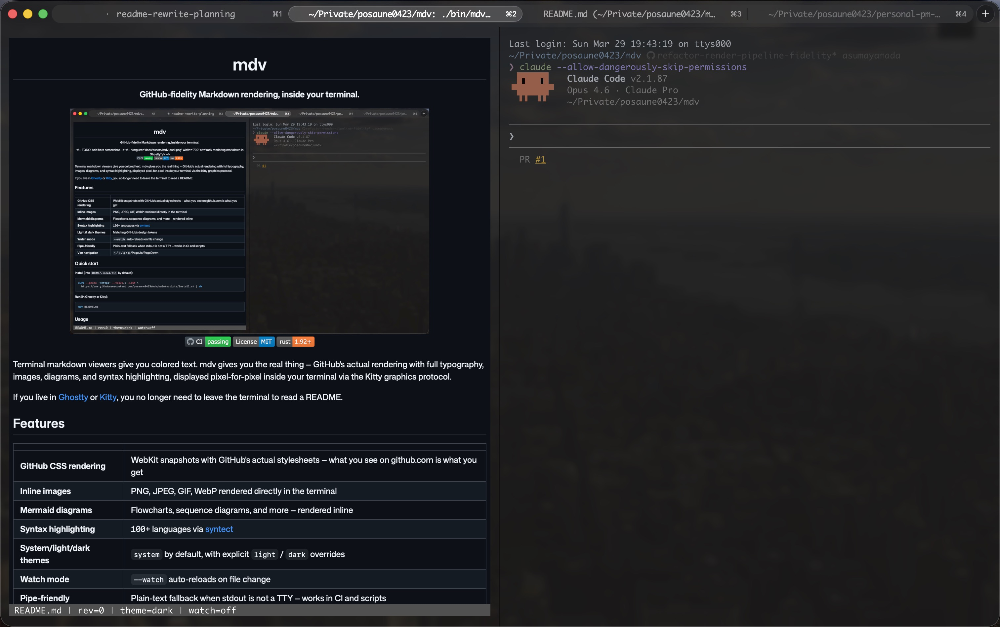

  
Section 1: architecture notes

  
Block 1 body rendered through GitHub HTML. It carries enough prose to be wrapped over several lines in the terminal viewport, so that layout work scales with the number of blocks rather than with a single paragraph.

  

    
  

### Centered heading 2

Paragraph 2 with inline HTML kept as text and a <a href="https://example.com/2">remote link</a>.

<picture>
  <source media="(prefers-color-scheme: dark)" srcset="assets/pixel.png" />
  <source media="(prefers-color-scheme: light)" srcset="assets/pixel.png" />
  
</picture>

   
  

  
Section 5: architecture notes

  
Block 5 body rendered through GitHub HTML. It carries enough prose to be wrapped over several lines in the terminal viewport, so that layout work scales with the number of blocks rather than with a single paragraph.

  

    
  

### Centered heading 6

Paragraph 6 with inline HTML kept as text and a <a href="https://example.com/6">remote link</a>.

<picture>
  <source media="(prefers-color-scheme: dark)" srcset="assets/pixel.png" />
  <source media="(prefers-color-scheme: light)" srcset="assets/pixel.png" />
  
</picture>

   
  

  
Section 9: architecture notes

  
Block 9 body rendered through GitHub HTML. It carries enough prose to be wrapped over several lines in the terminal viewport, so that layout work scales with the number of blocks rather than with a single paragraph.

  

    
  

### Centered heading 10

Paragraph 10 with inline HTML kept as text and a <a href="https://example.com/10">remote link</a>.

<picture>
  <source media="(prefers-color-scheme: dark)" srcset="assets/pixel.png" />
  <source media="(prefers-color-scheme: light)" srcset="assets/pixel.png" />
  
</picture>

   
  

  
Section 13: architecture notes

  
Block 13 body rendered through GitHub HTML. It carries enough prose to be wrapped over several lines in the terminal viewport, so that layout work scales with the number of blocks rather than with a single paragraph.

  

    
  

### Centered heading 14

Paragraph 14 with inline HTML kept as text and a <a href="https://example.com/14">remote link</a>.

<picture>
  <source media="(prefers-color-scheme: dark)" srcset="assets/pixel.png" />
  <source media="(prefers-color-scheme: light)" srcset="assets/pixel.png" />
  
</picture>

   
  

  
Section 17: architecture notes

  
Block 17 body rendered through GitHub HTML. It carries enough prose to be wrapped over several lines in the terminal viewport, so that layout work scales with the number of blocks rather than with a single paragraph.

  

    
  

### Centered heading 18

Paragraph 18 with inline HTML kept as text and a <a href="https://example.com/18">remote link</a>.

<picture>
  <source media="(prefers-color-scheme: dark)" srcset="assets/pixel.png" />
  <source media="(prefers-color-scheme: light)" srcset="assets/pixel.png" />
  
</picture>

   
  

  
Section 21: architecture notes

  
Block 21 body rendered through GitHub HTML. It carries enough prose to be wrapped over several lines in the terminal viewport, so that layout work scales with the number of blocks rather than with a single paragraph.

  

    
  

### Centered heading 22

Paragraph 22 with inline HTML kept as text and a <a href="https://example.com/22">remote link</a>.

<picture>
  <source media="(prefers-color-scheme: dark)" srcset="assets/pixel.png" />
  <source media="(prefers-color-scheme: light)" srcset="assets/pixel.png" />
  
</picture>

   
  

  
Section 25: architecture notes

  
Block 25 body rendered through GitHub HTML. It carries enough prose to be wrapped over several lines in the terminal viewport, so that layout work scales with the number of blocks rather than with a single paragraph.

  

    
  

### Centered heading 26

Paragraph 26 with inline HTML kept as text and a <a href="https://example.com/26">remote link</a>.

<picture>
  <source media="(prefers-color-scheme: dark)" srcset="assets/pixel.png" />
  <source media="(prefers-color-scheme: light)" srcset="assets/pixel.png" />
  
</picture>

   
  

  
Section 29: architecture notes

  
Block 29 body rendered through GitHub HTML. It carries enough prose to be wrapped over several lines in the terminal viewport, so that layout work scales with the number of blocks rather than with a single paragraph.

  

    
  

### Centered heading 30

Paragraph 30 with inline HTML kept as text and a <a href="https://example.com/30">remote link</a>.

<picture>
  <source media="(prefers-color-scheme: dark)" srcset="assets/pixel.png" />
  <source media="(prefers-color-scheme: light)" srcset="assets/pixel.png" />
  
</picture>

   
  

  
Section 33: architecture notes

  
Block 33 body rendered through GitHub HTML. It carries enough prose to be wrapped over several lines in the terminal viewport, so that layout work scales with the number of blocks rather than with a single paragraph.

  

    
  

### Centered heading 34

Paragraph 34 with inline HTML kept as text and a <a href="https://example.com/34">remote link</a>.

<picture>
  <source media="(prefers-color-scheme: dark)" srcset="assets/pixel.png" />
  <source media="(prefers-color-scheme: light)" srcset="assets/pixel.png" />
  
</picture>

   
  

  
Section 37: architecture notes

  
Block 37 body rendered through GitHub HTML. It carries enough prose to be wrapped over several lines in the terminal viewport, so that layout work scales with the number of blocks rather than with a single paragraph.

  

    
  

### Centered heading 38

Paragraph 38 with inline HTML kept as text and a <a href="https://example.com/38">remote link</a>.

<picture>
  <source media="(prefers-color-scheme: dark)" srcset="assets/pixel.png" />
  <source media="(prefers-color-scheme: light)" srcset="assets/pixel.png" />
  
</picture>

   
  

  
Section 41: architecture notes

  
Block 41 body rendered through GitHub HTML. It carries enough prose to be wrapped over several lines in the terminal viewport, so that layout work scales with the number of blocks rather than with a single paragraph.

  

    
  

### Centered heading 42

Paragraph 42 with inline HTML kept as text and a <a href="https://example.com/42">remote link</a>.

<picture>
  <source media="(prefers-color-scheme: dark)" srcset="assets/pixel.png" />
  <source media="(prefers-color-scheme: light)" srcset="assets/pixel.png" />
  
</picture>

   
  

  
Section 45: architecture notes

  
Block 45 body rendered through GitHub HTML. It carries enough prose to be wrapped over several lines in the terminal viewport, so that layout work scales with the number of blocks rather than with a single paragraph.

  

    
  

### Centered heading 46

Paragraph 46 with inline HTML kept as text and a <a href="https://example.com/46">remote link</a>.

<picture>
  <source media="(prefers-color-scheme: dark)" srcset="assets/pixel.png" />
  <source media="(prefers-color-scheme: light)" srcset="assets/pixel.png" />
  
</picture>

   
  

  
Section 49: architecture notes

  
Block 49 body rendered through GitHub HTML. It carries enough prose to be wrapped over several lines in the terminal viewport, so that layout work scales with the number of blocks rather than with a single paragraph.

  

    
  

### Centered heading 50

Paragraph 50 with inline HTML kept as text and a <a href="https://example.com/50">remote link</a>.

<picture>
  <source media="(prefers-color-scheme: dark)" srcset="assets/pixel.png" />
  <source media="(prefers-color-scheme: light)" srcset="assets/pixel.png" />
  
</picture>

   
  

  
Section 53: architecture notes

  
Block 53 body rendered through GitHub HTML. It carries enough prose to be wrapped over several lines in the terminal viewport, so that layout work scales with the number of blocks rather than with a single paragraph.

  

    
  

### Centered heading 54

Paragraph 54 with inline HTML kept as text and a <a href="https://example.com/54">remote link</a>.

<picture>
  <source media="(prefers-color-scheme: dark)" srcset="assets/pixel.png" />
  <source media="(prefers-color-scheme: light)" srcset="assets/pixel.png" />
  
</picture>

   
  

  
Section 57: architecture notes

  
Block 57 body rendered through GitHub HTML. It carries enough prose to be wrapped over several lines in the terminal viewport, so that layout work scales with the number of blocks rather than with a single paragraph.

  

    
  

### Centered heading 58

Paragraph 58 with inline HTML kept as text and a <a href="https://example.com/58">remote link</a>.

<picture>
  <source media="(prefers-color-scheme: dark)" srcset="assets/pixel.png" />
  <source media="(prefers-color-scheme: light)" srcset="assets/pixel.png" />
  
</picture>

   
  

  
Section 61: architecture notes

  
Block 61 body rendered through GitHub HTML. It carries enough prose to be wrapped over several lines in the terminal viewport, so that layout work scales with the number of blocks rather than with a single paragraph.

  

    
  

### Centered heading 62

Paragraph 62 with inline HTML kept as text and a <a href="https://example.com/62">remote link</a>.

<picture>
  <source media="(prefers-color-scheme: dark)" srcset="assets/pixel.png" />
  <source media="(prefers-color-scheme: light)" srcset="assets/pixel.png" />
  
</picture>

   
  

  
Section 65: architecture notes

  
Block 65 body rendered through GitHub HTML. It carries enough prose to be wrapped over several lines in the terminal viewport, so that layout work scales with the number of blocks rather than with a single paragraph.

  

    
  

### Centered heading 66

Paragraph 66 with inline HTML kept as text and a <a href="https://example.com/66">remote link</a>.

<picture>
  <source media="(prefers-color-scheme: dark)" srcset="assets/pixel.png" />
  <source media="(prefers-color-scheme: light)" srcset="assets/pixel.png" />
  
</picture>

   
  

  
Section 69: architecture notes

  
Block 69 body rendered through GitHub HTML. It carries enough prose to be wrapped over several lines in the terminal viewport, so that layout work scales with the number of blocks rather than with a single paragraph.

  

    
  

